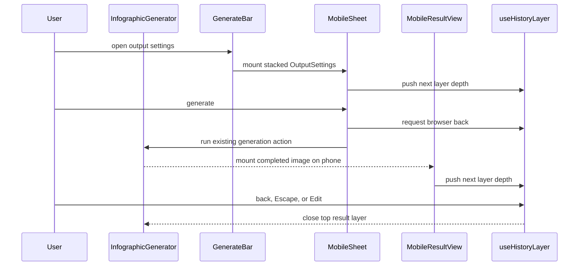
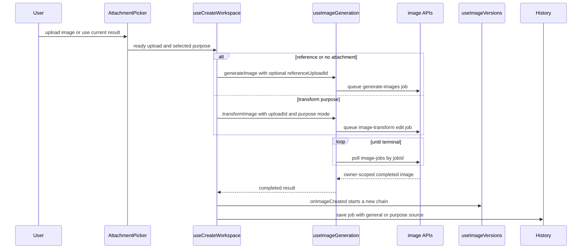
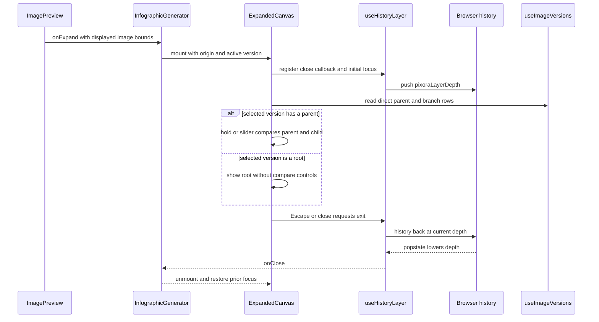
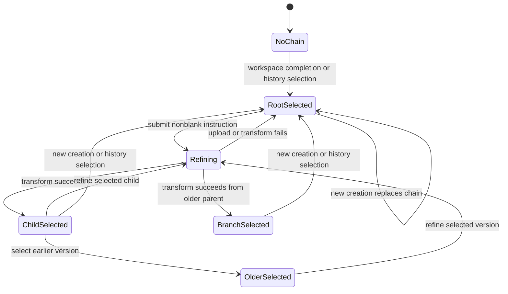
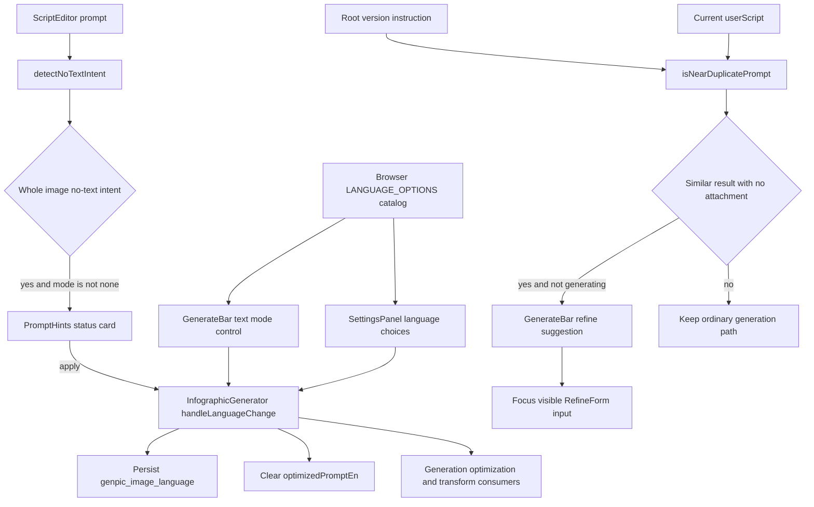
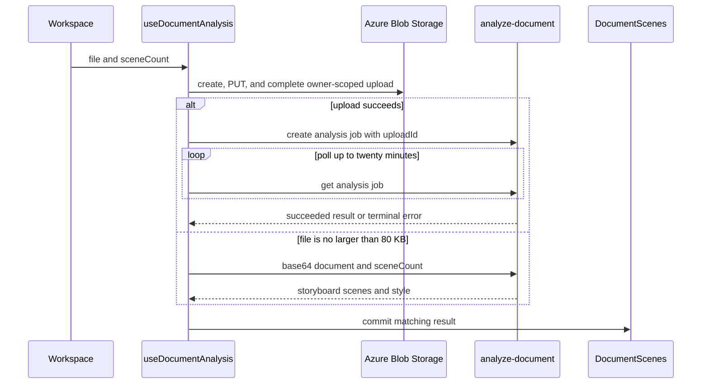
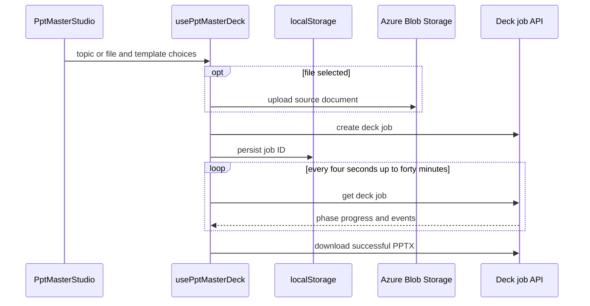

# Creation workspace, document storyboards, and exports

`InfographicGenerator.jsx` is the browser composition point for the unified creation workspace, document storyboards, settings, library, and PPT Master. Image transforms are no longer a tab: an optional attachment and its purpose route the same creation form to generation or editing. Shared asset lists compose through [Asset Center](asset-center.md); server model, prompt, and document contracts are canonical in [AI generation](../backend/ai-generation.md).

The document area has two intentionally independent paths: **Document storyboard** calls `useDocumentAnalysis` and renders `DocumentScenes`; **PPT Master** renders `PptMasterStudio` and owns durable deck-job state. The previous editable company-template presentation path is not a current browser or API surface. Do not introduce `slides`, `slideCount`, or a presentation `mode` into the document-analysis request without restoring a complete server contract, route registration, and consumer workflow.

## General image output settings

`InfographicGenerator` derives its active image-model configuration from the authenticated public profile: it finds `modelPolicy.defaultModel` in `imageModels`, initializes quality from that model's `defaultQuality`, and blocks generation or editing for a missing catalog/default or a quality no longer supported by that model. `OutputSettings` is the single aspect-ratio, catalog-quality, and in-image-text control surface. Desktop `GenerateBar` renders it as an inline row; compact phone mode renders only a result thumbnail, settings summary or progress, and the primary action, then opens the same controls in a stacked `MobileSheet`. Quality remains rendering effort, not resolution. Traditional Chinese and no-text are direct `aria-pressed` choices, other supported languages use the select, and transform purposes keep the same language state. The browser has no renderer/model picker: policy selection remains server-owned. Its `profileError` is also a configuration error rather than a reason to guess a model.

`generateImage` serializes `imageQuality` under the API field name `quality`, but it no longer submits a final `prompt` or a client-selected `model`. It sends `userScript`, optional reusable `stylePrompt`, palette `styleTags` as an array, `purpose`, `imageLanguage`, and aspect ratio; the BFF applies tenant model policy and assembles the final labeled prompt. `InfographicGenerator` owns ordinary-creation `imagePurpose`, initialized to `infographic`, and passes it through `ScriptEditor`'s `infographic`, `storyboard`, and `freeform` selector. Storyboard-scene generation remains fixed at `purpose: 'storyboard'`. `freeform` omits only deliverable-specific composition defaults; explicit canvas, style, reference, and text settings still reach the server. The other purposes add system composition only when content has not already specified framing. The client retains palette selections as an array so the server can normalize/de-duplicate them, while history still records a human-readable joined style string. `useImageGeneration` uses the returned `prompt` as `finalPrompt`; for queued GPT work that prompt arrives with the `202` job response.

## Phone creation layout and layered results

`useMediaQuery(MOBILE_LAYOUT_QUERY)` selects a structural phone layout below `768px`; CSS alone still owns purely visual responsiveness. On phones, `InfographicGenerator` omits both inline preview placements and passes `compact` to `GenerateBar`. A successful ordinary generation opens `MobileResultView`, a full-screen right-to-left detail surface that reuses the same `ImagePreview`, refinement form, version rows, download, sharing, and expand callbacks. Its **Edit** action returns to the form. The compact bar's thumbnail can reopen the result, while generation replaces the summary with compact progress and cancellation. `ImagePreview` limits the image with `55svh` so mobile browser chrome does not make the result overflow its visible viewport.

The settings summary opens `MobileSheet`, where `OutputSettings layout="stack"` preserves the desktop values and handlers. Generating from the sheet first requests its history-backed close and then calls `onGenerate`; the sheet does not stage a private settings copy. For a near-duplicate prompt, `focusRefineInput` uses `flushSync` to mount the phone result before finding and focusing `[data-refine-input]`, preserving the same gesture for virtual-keyboard activation. Document batch generation also receives compact controls, but does not pass a single result thumbnail.



This sequence shows phone presentation around the existing generation action. Each full-screen or sheet layer owns one `pixoraLayerDepth`; only the current depth reacts to Escape, and browser back drives the same close callback. `ExpandedCanvas` uses this same hook, so opening comparison from the result stacks above it instead of creating a competing marker. The shared lifecycle and mobile browser baseline are canonical in [shared UI motion, theme, and semantic icon styling](design-system.md).

For phone layout changes, start at `InfographicGenerator.jsx` and `useMediaQuery.js`, then follow `GenerateBar` -> `OutputSettings` / `MobileSheet` and `MobileResultView` -> `ImagePreview`. Preserve one settings state owned by `InfographicGenerator`, result/version state owned by `useImageVersions`, and one history entry per mounted layer. Do not use `useMediaQuery` for styling that can remain CSS-only. Run:

```sh
pnpm test --run src/__tests__/InfographicGenerator.test.jsx src/components/create/__tests__/GenerateBar.test.jsx src/components/create/__tests__/ExpandedCanvas.test.jsx src/hooks/__tests__/useHistoryLayer.test.jsx
```

The phone suite verifies structural preview removal, compact-bar composition, automatic full-screen result opening, the Edit/thumbnail return loop, and refine-hint opening. `GenerateBar.test.jsx` verifies summary-to-sheet settings, close-before-generate, thumbnail behavior, and compact progress. `useHistoryLayer.test.jsx` verifies stacked depths, topmost-only Escape, system back, initial focus, and return focus. These are jsdom checks; when changing safe areas, dynamic viewport units, virtual-keyboard behavior, or actual browser back gestures, add a real phone-browser check and run `pnpm build` because those changes cross the bundled CSS/browser-entry boundary.

## Optional attachment and transform-purpose routing

`AttachmentPicker` adds one optional image to the ordinary creation form. It accepts an uploaded image or re-uploads the current generated result through the owner-scoped lifecycle documented in [uploads](../backend/uploads.md). `useCreateWorkspace` stores the ready `uploadId`, preview, origin, filename, and `nearestAspectRatio` result. Files over 10 MB are rejected before upload. Clearing the attachment also resets its purpose to `reference`, preventing a hidden transform mode from surviving into a later plain request.

`src/lib/attachmentPurposes.js` is the routing catalog:

| Purpose | Endpoint path | Prompt required | Style context | Aspect ratio | History source |
|---|---|---:|---|---|---|
| `reference` | `generate-images` with `referenceUploadId` | yes | applied | user-selected | `general` |
| `refine` | `image-transform` | yes | ignored | nearest source ratio | `refine` |
| `bg_replace` | `image-transform` | no | applied | nearest source ratio | `bg_replace` |
| `element_extract` | `image-transform` | no | applied | nearest source ratio | `element_extract` |
| `style_transfer` | `image-transform` | no | applied | nearest source ratio | `style_transfer` |

`reference`, `refine`, `bg_replace`, and `element_extract` are shown beside the attachment. `style_transfer` is intentionally selected from the collapsible **Advanced: style** section, where it can be understood together with the chosen style. `ScriptEditor` changes its field label, placeholder, optimizer mode, and action copy from the active catalog entry; it hides the infographic/storyboard/freeform selector for transforms. `refine` deliberately clears style prompt, tags, and style ID before dispatch, while the other transform purposes may apply saved, analyzed, or palette style context.

The advanced style section is collapsed by default and remembers its open state under `genpic_advanced_style_open`. Its **style reference image** is a separate upload used only by `analyzeStyle`; it never populates the content attachment or `referenceUploadId`. This separation prevents style analysis from silently changing the generated subject. Applied style can be summarized and cleared while the section remains collapsed.



This sequence shows the browser routing layer and its completed-result handoff. The preview becomes available before history persistence, while endpoint admission and worker execution remain server-owned in [AI generation](../backend/ai-generation.md) and persisted purpose values are constrained by [schema](../data/schema.md).

`useImageGeneration::runImageJob` owns one progress clock, abort controller, filename request, admission validation, and owner-scoped polling for generation, transforms, and storyboard image work. It no longer owns `generatedImage` or any preview setter: the caller decides where a completed result is displayed. `useCreateWorkspace::submit` selects the adapter, forwards quality and image language, then invokes `onImageCreated` before `saveHistoryItem`; `InfographicGenerator` supplies `useImageVersions::startChain`, so a failed history write reports an error without hiding the finished image. Cancelling aborts browser waiting only; queued work can continue. Transform purposes disable ratio controls and display **use source aspect ratio**; `nearestAspectRatio` selects from the provider-supported ratio set before admission. Ordinary reference generation leaves ratio selection unlocked.

`getImageOutputLabel` remains the presentation formatter for unlocked output settings and `ImagePreview`. Its browser map still labels `16:9` as `1536×1024` and `9:16` as `1024×1536`, while the provider adapter requests `1536x864` and `864x1536`; treat that mismatch as a cross-layer correction. `GenerateBar` retains visible status text and a decorative `Loader2`; `ImageGeneratingState` remains an atomic busy region with reduced-motion-safe animation. Their presentation contract is documented in [shared UI motion, theme, and semantic icon styling](design-system.md).

For an attachment purpose, change `attachmentPurposes.js`, `useCreateWorkspace.js`, `AttachmentPicker.jsx`, `ScriptEditor.jsx`, `InfographicGenerator.jsx`, server prompt mode handling, history source normalization/labels, and migration constraints together. A purpose is not complete if only the UI catalog knows it. For dispatch or job lifecycle changes, follow `useCreateWorkspace::submit` -> `useImageGeneration::runImageJob` -> `aiService` -> the owning handler; preserve `jobId`, model, and operation checks. For ratio detection, change `imageFile.js`; for provider dimensions, change `api/_shared/gptImage.js`. The removed `ImageTransformPanel` and `useImageTransform` are not extension seams.

```sh
pnpm test --run src/hooks/__tests__/useImageVersions.test.js src/hooks/__tests__/useImageRefine.test.js src/components/create/__tests__/ImagePreview.test.jsx src/hooks/__tests__/useCreateWorkspace.test.js src/__tests__/InfographicGenerator.test.jsx src/hooks/__tests__/useImageGeneration.test.js src/components/create/__tests__/AttachmentPicker.test.jsx src/components/create/__tests__/ScriptEditor.test.jsx src/components/create/__tests__/GenerateBar.test.jsx src/lib/__tests__/imageFile.test.js
```

`useCreateWorkspace.test.js` covers no-attachment generation, reference attachment routing, every transform purpose, refine style suppression, prompt requirements, source-ratio locking, reset, 10 MB rejection, current-result reuse, and the completed-result callback before a failing history write. `AttachmentPicker.test.jsx` covers upload, purpose choice, removal, and the one-time merged-tab notice. `InfographicGenerator.test.jsx` verifies reference and transform orchestration, purpose history, style-reference isolation, model-policy guards, returning to plain generation after removal, preview-refinement composition, near-duplicate suggestion wiring, and expanded-canvas open/Escape close. `ScriptEditor.test.jsx` covers transform optimizer context and persisted advanced-style state; `GenerateBar.test.jsx` covers disabled ratio controls plus the non-blocking refine suggestion. `useImageGeneration.test.js` proves generation and transform share admission/polling and operation validation without asserting preview ownership. These are browser/mocked checks, not a live Blob, worker, provider, or migration test.

## Refine-this-image preview, expanded comparison, and version branches

`InfographicGenerator` derives the displayed image from `useImageVersions::activeVersion`; `useImageGeneration` is deliberately limited to image-job lifecycle state. Every ordinary workspace completion calls `useCreateWorkspace`'s `onImageCreated` callback, which starts a fresh one-item chain. Choosing a history item also starts a fresh chain, marks its root `fromHistory`, and causes `ImagePreview` to label it as a compressed preview. Neither path restores prior versions, and the chain is React memory only: it is not persisted and disappears when the workspace unmounts.

`ImagePreview` keeps the shared `RefineForm` beside the result and delegates branch thumbnails to the shared `VersionStrip`. A nonblank instruction calls `useImageRefine::refine`; while that job runs, the selected image remains visible at reduced opacity with the shared `generationStatus` overlay rather than switching to the empty generation placeholder. Success clears the submitting form and selects the new version. A transform, upload, model-setup, or job failure leaves the current version and instruction intact and displays `refineError` inline. If only `saveHistoryItem` fails, the new version remains selected and the inline warning explains that the edit completed but was not recorded.

`ImagePreview` also measures the displayed image and calls `onExpand`; `InfographicGenerator` converts that rectangle into a transform origin and retains `ExpandedCanvas` inside `AnimatePresence`. The full-workspace dialog reads the selected version and its direct parent from `useImageVersions`, then reuses `RefineForm` and `VersionStrip`, so selecting or refining inside it changes the same active in-memory chain as the inline preview. A root version renders alone. A child defaults to `HoldCompare`: pointer hold on the image/button or keyboard hold on Space temporarily shows the parent, except while typing. `SliderCompare` overlays the parent and current image with a pointer-captured divider; Arrow keys move five percentage points and Home/End select the endpoints.



This sequence shows the expanded canvas lifecycle after it joined the shared history-layer stack. Browser back, Escape, and the visible close control converge on the depth-owned history entry rather than navigating away from the creation route; only the topmost layer responds to Escape. If the current history depth no longer matches the canvas depth, `requestClose` invokes the latest supplied close callback directly. The canvas uses the shared Motion enter/exit tokens documented in [shared UI motion, theme, and semantic icon styling](design-system.md), respects top and bottom safe-area insets, and makes the bottom refine/version surface opaque under reduced-transparency preference. The shared hook suite now covers stacked Escape, system back, and focus restoration. The canvas suite still does not assert pointer dragging/cancellation on the slider or completed Motion exit timing; treat those as manual/added-test conditions when changing those details.



This lifecycle shows selection and branch behavior. A refinement always records the version selected when the request starts as `parentId`; therefore selecting an older node before refining creates a sibling branch rather than rewriting or discarding existing descendants.

`useImageVersions` assigns monotonic display labels from insertion order, stores each node's `jobId`, `imageUrl`, instruction, `parentId`, timestamp, optional cached upload, and history-origin flag, and derives branch rows through `buildVersionRows`. The first child continues its parent's row; later children begin indented branch rows. The standalone `VersionStrip` is hidden for a single node in both preview surfaces and exposes each visible version as an accessible thumbnail with its version label and instruction.

`useImageRefine` converts the selected data URL or fetchable image URL through `imageUrlToFile`, uses [owner-scoped uploads](../backend/uploads.md) to create one ready image upload, reads the source dimensions, and caches `{ uploadId, aspectRatio }` on that version. Every later refinement from the same version—including a second branch—reuses the cached upload. It dispatches `transformImage` with `mode: "refine"`, the nearest supported source ratio, current catalog quality, and image-text language. A successful job becomes a child before history persistence and is then recorded by [resources](../backend/resources.md) with `source: "refine"`, empty style, and the short instruction as `userScript`; the allowed source value is owned by [schema](../data/schema.md). The prompt-preservation and provider execution contract remains in [AI generation](../backend/ai-generation.md).

### Behavioral test matrix

| Behavior | Observable invariant | Narrowest evidence |
|---|---|---|
| Initial ordinary result | `onImageCreated` starts and selects a root before history persistence | `useCreateWorkspace.test.js`, case “shows the finished image even when the history write fails”; `useImageVersions.test.js`, case “starts a chain with a root version” |
| History selection | Replaces the chain with one `fromHistory` root and shows the compressed-preview label | `useImageVersions.test.js`, case “replaces the chain when a new one starts”; `ImagePreview.test.jsx`, compressed-history case |
| Selected-version refinement | Successful edit is a selected child of the source version and history source is `refine` | `useImageRefine.test.js`, case “refines the selected version, records history and adds a child version” |
| Branching and isolation | Selecting the root and refining again creates a second row; existing descendants remain | `useImageRefine.test.js`, case “uploads each version only once, including when branching”; `useImageVersions.test.js`, `buildVersionRows` suite |
| Upload reuse | A source version is uploaded once even when it is refined into multiple branches | `useImageRefine.test.js`, upload-once branch case; `InfographicGenerator.test.jsx`, version-chain integration case |
| In-flight UI | The selected image stays visible and dimmed; the refine action is disabled | `ImagePreview.test.jsx`, case “dims the current image while refining instead of showing the generation screen” |
| Expanded child comparison | Hold by pointer or Space reveals the direct parent; slider keyboard movement is clamped from 0 to 100 | `ExpandedCanvas.test.jsx`, cases “shows the parent while the image or compare button is held”, “holds the parent with the space key unless typing”, and “moves the before/after slider with the keyboard” |
| Expanded root | A root renders without comparison-mode controls because it has no parent | `ExpandedCanvas.test.jsx`, case “shows a root version without compare controls” |
| Close and navigation | Opening increments `pixoraLayerDepth`; Escape, close, and browser back close only the top layer, while initial and return focus are preserved | `useHistoryLayer.test.jsx`, stack and system-back cases; `ExpandedCanvas.test.jsx`, close/history case; `InfographicGenerator.test.jsx`, expanded-canvas integration case |
| Job or setup failure | Current selection and instruction remain; no child is added and an inline alert is shown | `useImageRefine.test.js`, job/setup failure cases; `ImagePreview.test.jsx`, inline-error case |
| History-only failure | Child remains selected while `refineError` reports that persistence failed | `useImageRefine.test.js`, case “keeps the refined version when only the history write fails” |
| New-chain boundary | A later creation or history selection discards the prior in-memory tree | `useImageVersions.test.js`, replacement case |

For preview/refinement changes, follow `InfographicGenerator` -> `ImagePreview`, `MobileResultView`, or `ExpandedCanvas` -> `RefineForm` / `VersionStrip` -> `useImageRefine` -> `useImageVersions`, then the shared `useImageGeneration::transformImage` lifecycle. Keep the ownership split explicit: `InfographicGenerator` owns which result/canvas surface is mounted and the canvas origin; `MobileResultView` owns only phone presentation; `ExpandedCanvas` owns only compare mode; `useHistoryLayer` owns layered close/focus mechanics; and no preview surface owns the version tree. Do not restore preview state to `useImageGeneration`, and do not move version-tree concerns into `useCreateWorkspace`. If adding fields to a version, update `startChain`, `addVersion`, branch layout, all preview consumers, and the hook/component suites. If changing layer close behavior, preserve depth stacking, topmost-only Escape, one listener pair per layer, current-callback refs, initial/return focus, and each owner `AnimatePresence`; test Escape, visible close, browser back, and nested layers separately. If changing upload reuse, source-ratio selection, or accepted URLs, update `useImageRefine`, `imageFile.js`, [uploads](../backend/uploads.md), and the refine hook tests. Changes to persisted branch relationships would cross the current in-memory boundary and require a new server/schema design; no such contract exists today.

Run the focused refine seam:

```sh
pnpm test --run src/hooks/__tests__/useImageVersions.test.js src/hooks/__tests__/useImageRefine.test.js src/components/create/__tests__/ImagePreview.test.jsx src/components/create/__tests__/ExpandedCanvas.test.jsx src/hooks/__tests__/useHistoryLayer.test.jsx src/hooks/__tests__/useCreateWorkspace.test.js src/hooks/__tests__/useImageGeneration.test.js src/__tests__/InfographicGenerator.test.jsx
```

Run `pnpm lint` only when changing hook dependencies, JSX accessibility, or import policy, and `pnpm build` when changing bundled dependencies, CSS/Tailwind utilities, or the browser entry surface. Live Blob/provider checks are conditional on changing those integration boundaries; the focused suites mock them.

## Image-text preference and optimization flow

`InfographicGenerator` initializes `imageLanguage` from `localStorage` key `genpic_image_language`, with `DEFAULT_IMAGE_LANGUAGE` as the fallback, and persists every change through `handleLanguageChange`. The general/storyboard `GenerateBar`, the general `ScriptEditor` hint action, and `SettingsPanel` all receive that same state and setter, so a choice made beside generation is immediately reflected in settings and subsequent requests. The setting controls text rendered **inside generated images**, not the browser UI language or the language of a user's prompt. Changing language or aspect ratio clears `optimizedPromptEn`, preventing an optimized content brief from being reused under changed optimizer context.

`src/lib/imageTextLanguage.js` is the canonical browser option catalog. `LANGUAGE_OPTIONS` supplies IDs and all labels to `GenerateBar` and `SettingsPanel`; `NO_TEXT_LANGUAGE` names the `none` value; `getLanguageOption` falls back to `DEFAULT_IMAGE_LANGUAGE` for an unknown ID; and `getImageTextModeLabel` formats the bar summary. This browser catalog must remain aligned with the accepted server IDs in `api/_shared/imageTextLanguage.js`, but the two modules have different ownership: the browser module owns choices and labels, while the server module owns prompt directives.

`ScriptEditor` calls the pure `detectNoTextIntent` rule for the current prompt. The rule deliberately recognizes only conservative whole-image Chinese and English requests such as no text, without text, or remove all text; it rejects local subjects such as a title, sign, or background and qualifiers such as too much text. When intent matches and `imageLanguage` is not `none`, `ScriptEditor` supplies a hint descriptor to `PromptHints`. The reusable card is a `role="status"` region with a primary action and dismiss action: applying it calls `handleLanguageChange('none')`, while dismissal records the exact current prompt string. The hint remains dismissed until the prompt value changes, and choosing no-text hides it. Its CSS entry uses the shared duration/easing and a reduced-motion translation fallback from [shared UI motion, theme, and semantic icon styling](design-system.md); it does not change generation automatically.

A second, deliberately separate rule steers small follow-up changes toward refinement. `isNearDuplicatePrompt` normalizes surrounding/repeated whitespace and case, rejects missing strings or pairs whose shorter length is below 80% of the longer, then computes character-level Levenshtein similarity and accepts at least `0.8`. `InfographicGenerator` compares the current `userScript` with the root version's instruction only while a generated result exists and no content attachment is active. It passes `onSuggestRefine` to `GenerateBar`; the bar hides the suggestion while generating, but otherwise keeps the normal generation action enabled. Activating the hint scrolls to and focuses the currently visible `[data-refine-input]`, whether it belongs to the inline preview or expanded canvas. The rule is advisory and client-only: it neither changes the prompt nor dispatches a request.



This flow shows the single browser preference owner and the two advisory prompt paths. The no-text hint recommends a persisted setting change, while the near-duplicate hint only redirects focus toward refinement; neither submits generation or refinement automatically.

`ScriptEditor::handleSmartOptimize` calls `aiService::optimizePrompt` with `optimizationMode: 'generation'` for plain/reference generation and switches to `optimizationMode: 'transform'` plus the attachment purpose as `transformMode` for edits. It also sends style context, image language, image purpose, and aspect ratio; purpose, attachment, language, ratio, or style changes clear the stored optimized English brief. `DocumentScenes::SceneModal` calls `aiService::optimizeScene` with scene fields and the same applicable context. `AssetMetadataSheet` uses `optimizationMode: 'style_description'` to improve unsaved style prose. `aiService.js` is the common serialization seam. The server-side strategy and final prompt contract are canonical in [AI generation](../backend/ai-generation.md); every wrapper or reshaped request must preserve its applicable context.

For a new language ID, update `src/lib/imageTextLanguage.js` first, then reconcile the browser controls and settings tests, the accepted IDs and directives in `api/_shared/imageTextLanguage.js`, `imagePrompt.js`, `imagePromptStrategy.js`, generation and transform paths, and both optimizer request paths. Do not restore a private option list in `SettingsPanel` or `GenerateBar`. For a new prompt-coaching rule, keep detection pure in `src/lib/promptHints.js` and put state/action ownership at the composition level that has all prerequisites: `ScriptEditor` owns no-text dismissal, while `InfographicGenerator` owns the cross-preview near-duplicate suggestion because it needs the version root, attachment state, generation state, and visible refine input. Keep `PromptHints` generic for editor-local cards and keep `GenerateBar` suggestions non-blocking. Test detector positives and conservative false positives separately from component visibility, action wiring, and continued access to ordinary generation.

The server helper accepts only `en`, `zh-TW`, `zh-CN`, `ja`, `ko`, `es`, `fr`, `de`, and `none`; absent or unsupported values intentionally produce no extra directive. For a recognized language, quoted literal text stays exactly as authored and is rendered only at the requested count; necessary requested text without exact wording uses the selected language, while filler text is forbidden. `none` prohibits all text. `freeform` retains this explicit setting, despite omitting purpose-specific composition defaults. `InfographicGenerator.test.jsx` proves the bar choice updates the editor-facing state, local storage, and the generation request; `GenerateBar.test.jsx` proves direct choice state, other-language display, and summary text; `SettingsPanel.test.jsx` proves it renders the shared catalog; `promptHints.test.js` covers whole-image matches, local/unrelated exclusions, normalized near matches, substantial changes, and missing values; `ScriptEditor.test.jsx` covers the no-text offer, action, suppression, and prompt-scoped dismissal; `GenerateBar.test.jsx` proves the refine suggestion is hidden while generating and does not block ordinary generation; and `InfographicGenerator.test.jsx` covers suggestion composition after a result and removal after a substantial prompt change. These remain browser tests: there is still no focused optimizer-handler test, and `aiService.test.js` does not assert either optimization payload.

```sh
pnpm test --run src/lib/__tests__/promptHints.test.js src/components/create/__tests__/GenerateBar.test.jsx src/components/create/__tests__/ScriptEditor.test.jsx src/components/settings/__tests__/SettingsPanel.test.jsx src/__tests__/InfographicGenerator.test.jsx
```

Run the server prompt contract separately only when changing accepted IDs, directives, or optimizer context:

```sh
pnpm test --run api/_shared/__tests__/imagePromptStrategy.test.js api/_shared/__tests__/imagePrompt.test.js api/_shared/__tests__/imageTextLanguage.test.js
```

## Document upload and storyboard analysis

`DocumentUploader` accepts one supported file, permits a 1–10 or `auto` scene count, and has a 50 MB browser limit. It uses `src/lib/documentFormats.js` for the accept attribute, extension validation, and MIME fallback. The allowed set is PDF; Word, PowerPoint, and Excel variants; OpenDocument; RTF; EPUB; CSV; TXT/Markdown; and PNG/JPEG. It does not accept a pasted outline mode.



This diagram covers client transport only; server-owned upload authorization is canonical in [Owner-scoped uploads and staged Blob storage](../backend/uploads.md), while parsing, model selection, normalization, and the durable queue are in [AI generation](../backend/ai-generation.md).

`useDocumentAnalysis` uses `storageService::uploadFile` first: create the record, direct-PUT the fixed staging URL, and complete promotion before it calls `aiService::analyzeDocument`. With an `uploadId`, that adapter creates a document job and polls it every two seconds for up to twenty minutes; it returns the persisted `result` only after `succeeded`, and propagates terminal job errors. After an upload failure it sends base64 only for files at most 80 KB to the synchronous fallback. It commits state only when `result.scenes` is nonempty. `AnalysisProgress` is elapsed-time/coarse-phase feedback capped below completion; it is not queue telemetry. `clearDocument` clears the local result, selected-file metadata, phase, and error.

For browser format, upload, or request-shape work, update `documentFormats.js`, `DocumentUploader.jsx`, `useDocumentAnalysis.js`, `storageService.js`, and `aiService.js` together, then align the server pages linked above. Do not send a document URL, SAS token, container, or filename as a trusted analysis source once an upload ID exists. `documentFormats.test.js` covers extension acceptance/MIME fallback; `storageService.test.js` covers browser grant validation and the create-PUT-complete flow; `aiService.test.js` covers document-job serialization/polling.

```sh
pnpm test --run src/lib/__tests__/documentFormats.test.js src/services/__tests__/storageService.test.js src/services/__tests__/aiService.test.js src/hooks/__tests__/useDocumentAnalysis.test.js
```

## Storyboard editing and browser exports

Storyboard responses contain scenes plus a required AI-recommended style. `DocumentScenes` uses the recommendation by default; applying a saved style creates a local `documentStyleOverride`, and clearing/replacing the document clears that override. Scene generation uses the selected prompt as `analyzedStyle`, saves output to history, and marks a saved style as used only for an explicit override.

`useDocumentAnalysis::updateScene` merges edits by index. `removeScene` removes an item, reassigns `scene_number` in display order, and synchronizes `total_scenes`. These are local draft changes. Keep the scene contract separate from the server's normalization boundary: users can edit data after it was normalized.

`DocumentScenes` retains `SceneModal` in `AnimatePresence`; the modal overlay and its panel fade/scale with `OVERLAY_ENTER` / `OVERLAY_EXIT`. Its private zoomable `ImageLightbox` is also retained in an inner presence boundary, so closing it does not snap away. This private component is separate from the shared `src/components/common/ImageLightbox.jsx` used by the Asset Center and administration panel; do not merge them as a motion-only edit because their interaction and accessibility contracts differ. The style picker and source-text disclosure retain CSS entry animation using the shared enter token and explicitly disable it for reduced-motion users.

`DocumentScenes::exportToPptx()` passes valid object scenes to `src/utils/pptxExport.js`. The browser dynamically loads `pptxgenjs`, fetches/base64-embeds available images, and downloads a 16:9 deck. PDF is also browser output. Valid native table/chart data takes precedence over a generated image or placeholder. The pure exporter retains image-less valid scenes once an export action is available.

`getPptxTables` and `getPptxCharts` re-normalize editable data: one table/chart, eight table columns, ten rows, twelve chart labels, and four series. `pptxExport.test.js` covers valid scene selection, image-less scenes, bullet fallback, filename sanitization, table limits, and chart aliases/numbers.

```sh
pnpm test --run src/utils/__tests__/pptxExport.test.js
```

## PPT Master design-deck workflow

`PptMasterStudio` is an asynchronous topic-or-document deck generator, distinct from the document storyboard. It accepts a topic of at least four characters or an optional supported file, limits a file to 50 MB, selects sidecar-provided style/layout plus `none`, `key`, or `every` image density, and allows 4–20 slides. The selected file uploads to `uploads`; `usePptMasterDeck::generate` creates the durable job.

The studio keeps these inputs in one `setup` object. `DeckSetupForm` is its controlled editor, organized as collapsible content, specification, and visual-design sections; it emits field patches and contains the recipe prefill rule. Before generation, `DeckBlueprint` derives its title, setup digest, and optional selected-style samples from that object. This keeps the preflight summary and submitted job input aligned without giving the blueprint its own state. Once a job is generating or ready, `DeckSetupSummary` collapses the form but can reopen it for inspection; it does not alter an already submitted job.



This sequence shows the PPT Master browser lifecycle from setup through server-owned job completion.

`DeckRecipePicker` appears before the normal topic/template settings. It selects `general` or a purpose-driven recipe and applies only local suggestions for slide count, image density, and a preferred style that is actually present in the fetched catalog; users may change all three afterwards. `PptMasterStudio` also collects optional purpose, audience, and intended-outcome fields, each capped at 200 characters to match the handler. `usePptMasterDeck::generate` -> `aiService::createDeckJob` forwards `recipeId` and the three brief fields alongside the existing job input. The recipe controls narrative structure; style/layout controls visual intent. Server normalization, persistence, design-system generation, and enforced spine behavior are canonical in [PPT Master deck jobs](../backend/ppt-master-decks.md).

`PptTemplatePicker` remains a text-first selector. `DeckBlueprint` is now the sole pre-generation display for static SVG samples from `templatePreviewManifest.js`; it shows the selected style's samples alongside the setup digest. A template with no manifest entry, or an image that fails to load, still renders as a selectable text card or an empty blueprint state. Samples demonstrate color, type, and decorative vocabulary—not deterministic page geometry—because production pages are independently authored. The manifest and `public/template-previews/styles/` SVG pairs are generated browser assets: `node api/scripts/generate-style-previews.cjs` is their producer, and it must be rerun after a PPT Master version, design-system, or frame change. Their generation pipeline is described in [PPT Master deck jobs](../backend/ppt-master-decks.md); the API registry is documented in [HTTP API](../backend/http-api.md).

The hook stores the active job under `genpic_deck_job`. On mount, queued/processing jobs resume polling; succeeded jobs restore the download state; a missing job clears the ID without an error; a terminal failure clears it with the server message. `waitForDeckJob` polls every four seconds for up to forty minutes, propagates `AbortError`, `AuthExpiredError`, and `404` immediately, retries other poll errors until five consecutive failures, and retains the ID after transient failure. `stopWatching` stops local browser I/O and removes continuation state; it does not cancel server work.

Previews are keyed by slide revision. `usePptMasterDeck` fetches each needed SVG once, exposes an object URL, refetches after a revision changes, revokes replaced/reset/unmounted URLs, and treats preview failure as non-fatal to job lifecycle. `DeckPreviewStage` composes the large current-page image with `DeckSlideRail`. With no explicit selection, `PptMasterStudio` passes the highest authored preview as the stage page, so the stage follows progress. Selecting a rail item or previous/next navigation pins that page; `回到最新` clears the selection and resumes following. The rail remains a sandboxed `` representation of the server-authored SVG and provides placeholders for planned but not-yet-authored pages. `DeckProgress` and `DeckTimeline` consume the append-only server event trace; `buildTimeline` sorts events by ID and keeps the newest state per step and per slide.

The studio's persistent action/status row renders the shared `GenerationSignature` before its textual hint. It derives `working` while `isGenerating`, `success` once `deck` exists and generation has ended, and `idle` otherwise; the success state uses `text-success`, while the other states use `text-primary`. This is a decorative lifecycle cue (`aria-hidden`), not deck-job state or an additional completion condition: the hook and server response remain authoritative. Its animation and reduced-motion behavior are owned by [shared UI motion, theme, and semantic icon styling](design-system.md).

For studio composition, setup forwarding, blueprint samples, polling, event, or preview changes, start with `PptMasterStudio.jsx`, `DeckSetupForm.jsx`, `DeckSetupSection.jsx`, `DeckBlueprint.jsx`, `DeckPreviewStage.jsx`, `DeckSlideRail.jsx`, `DeckRecipePicker.jsx`, `pptRecipeCopy.js`, `PptTemplatePicker.jsx`, `templatePreviewManifest.js`, `usePptMasterDeck.js`, `DeckProgress.jsx`, `DeckTimeline.jsx`, `deckSteps.js`, and `aiService.js`, then follow the durable job seam in [PPT Master deck jobs](../backend/ppt-master-decks.md). Do not hand-edit `templatePreviewManifest.js` or files under `public/template-previews/styles/`; regenerate them from the canonical script when a source-backed preview change is required. `PptMasterStudio.test.jsx` covers idle blueprint and disabled submission, setup collapse, planned-page placeholders, latest-page following, manual pinning and return to latest, image-density forwarding, recipe prefill/available-style behavior, and structured-brief forwarding; it does not assert the action-row `GenerationSignature` state or color mapping. `pptRecipeCopy.test.js` ensures frontend options and defaults match backend recipe IDs and accepted slide range; `templatePreviewManifest.test.js` verifies declared files exist and missing entries return an empty list. `usePptMasterDeck.test.jsx` covers resumption, missing/failed jobs, transient failure, stop tracking, preview revision caching, URL release, and non-fatal preview failure. These are not handler, Blob, worker, or authorization tests.

```sh
pnpm test --run src/components/create/__tests__/PptMasterStudio.test.jsx src/components/create/__tests__/pptRecipeCopy.test.js src/components/create/__tests__/templatePreviewManifest.test.js src/hooks/__tests__/usePptMasterDeck.test.jsx src/services/__tests__/aiService.test.js
```

## Change navigation

Consult this page for React composition, document upload/fallback, storyboard state, browser exports, or the PPT Master browser lifecycle. Start with `InfographicGenerator.jsx` to identify the active path. For a storyboard modal or inline creation-panel animation, change the owner and child together: `DocumentScenes` owns the outer and nested `AnimatePresence` boundaries, while `SceneModal` and its private zoom lightbox own Motion props. Preserve Escape/backdrop behavior and use the shared tokens from [shared UI motion, theme, and semantic icon styling](design-system.md); no focused test currently proves these exits. Use [AI generation](../backend/ai-generation.md) for document/model/provider changes, [PPT Master deck jobs](../backend/ppt-master-decks.md) for deck worker or contract changes, [HTTP API](../backend/http-api.md) for public route/OpenAPI changes, and [operations](../operations/development-deployment.md) only for configuration or deployment work.
