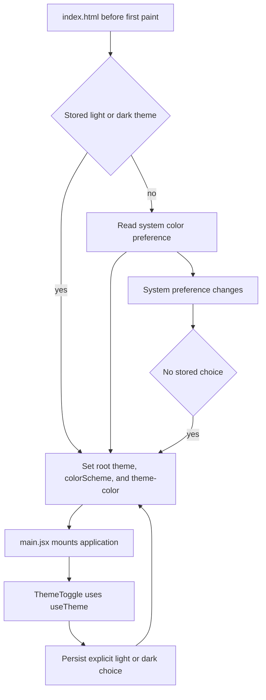
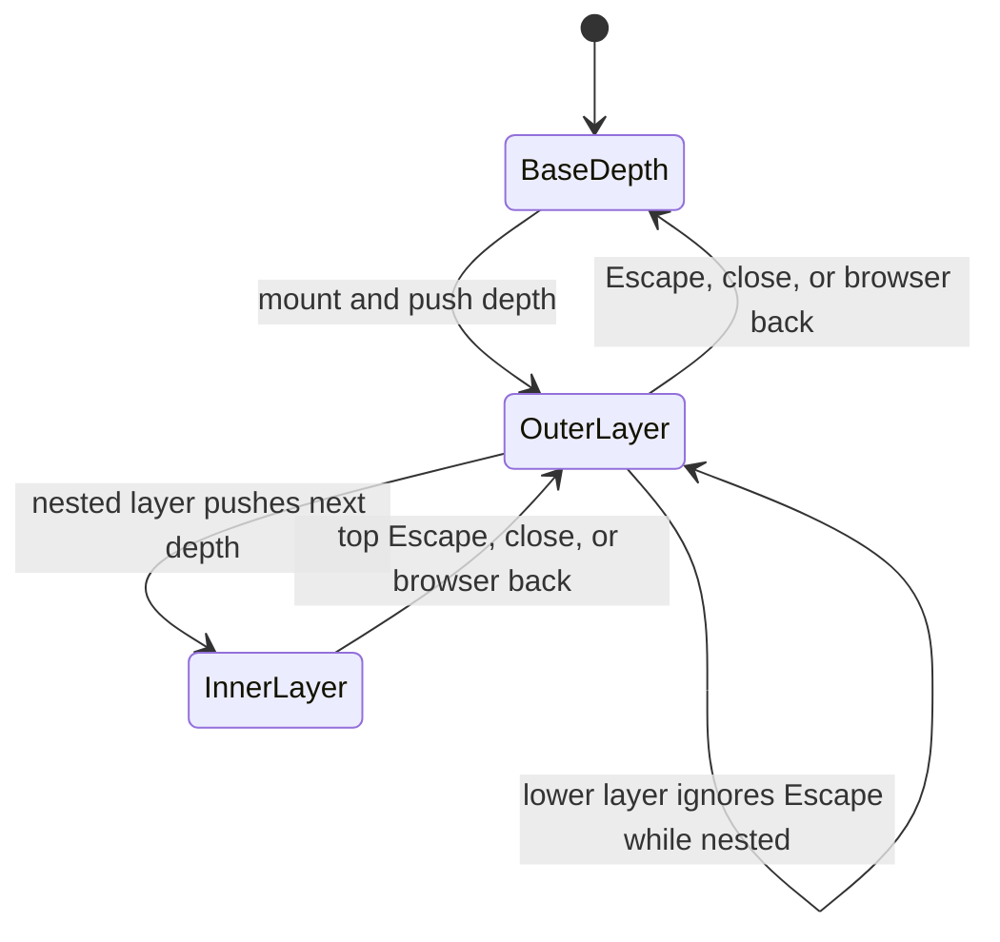
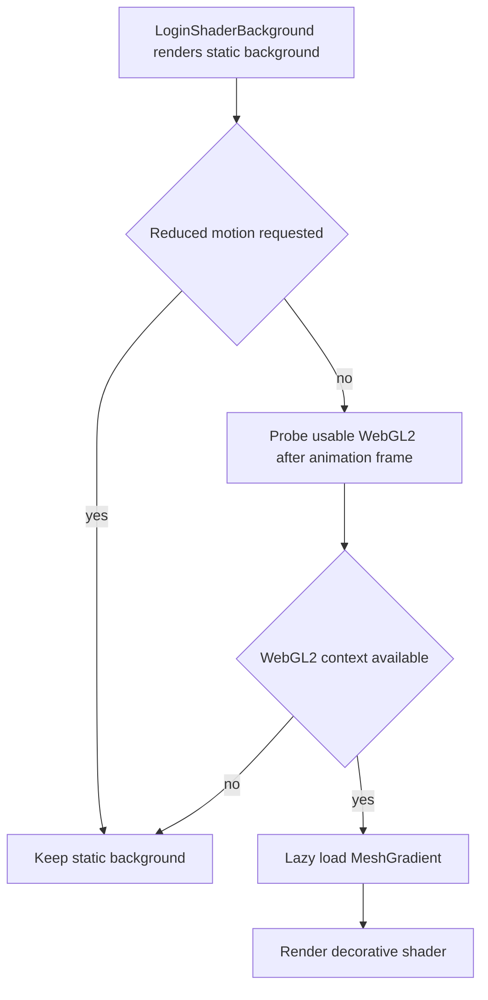

# Shared UI motion, theme, mobile browser baseline, and semantic icons

This page is the canonical browser-foundation boundary for the React application in [browser application](application.md). `src/main.jsx` wraps the authenticated app in `MotionProvider`; `InfographicGenerator` surfaces `ThemeToggle`; feature components consume semantic icon components or exports from the curated Lucide registries rather than importing arbitrary icon implementations. It is shared infrastructure, not a resource, API, or product-workflow owner. Feature behavior remains canonical in [creation workflows](create-workflows.md) and [Asset Center](asset-center.md).

## Theme lifecycle

`index.html` runs a small pre-paint script before the application mounts. It reads `localStorage["pixora.theme"]`; only `light` and `dark` are accepted, otherwise it uses `prefers-color-scheme`. It sets the root `dark` class, `colorScheme`, and the `theme-color` meta value before React loads, preventing a wrong-theme flash and aligning supported mobile browser chrome with the primary header (`#2563eb` light, `#3b82f6` dark). `src/lib/theme.js::applyTheme` updates those same three surfaces at runtime; keep its `THEME_COLORS` values byte-aligned with the pre-paint script. `useTheme` subscribes with `useSyncExternalStore`, and `ThemeToggle` changes the stored explicit choice while keeping its accessible label synchronized with the target state.



This shows the source-backed theme resolution path. An explicit choice always wins; the `matchMedia` listener updates the root only while no valid stored choice exists. Do not introduce a second theme key, React-only initialization, or a server-side preference source without updating both the pre-paint and runtime boundaries.

`src/index.css` provides separate light and dark token sets. The light tokens distinguish the page background, inset muted surface, and white card/popover elevation; dark tokens make card and popover surfaces progressively lighter than the root background. The theme is therefore an application-wide visual contract, not an isolated toggle decoration.

## Mobile browser and layered-overlay baseline

`index.html` opts into `viewport-fit=cover` and `interactive-widget=resizes-content`. The authenticated shell then uses `100dvh`, left/right safe-area padding, top header padding, and bottom-navigation padding. `MobileResultView`, `MobileSheet`, and `ExpandedCanvas` own their local top or bottom inset where they cover the shell. `ImagePreview` uses `svh` for its maximum image height. Preserve this split: the root owns viewport height and horizontal insets, while a fixed full-screen layer owns the inset at the edge it visually replaces.

The base CSS establishes phone interaction policy across features:

- `html` removes the WebKit tap highlight, fixes text-size adjustment at 100%, and disables page overscroll; `body` also disables overscroll because the app supplies explicit scrolling containers.
- Buttons, links, summaries, labels, and role buttons use `touch-action: manipulation`; button-like roles are non-selectable. Scrollable sheets/results use `overscroll-contain` locally.
- Under `(pointer: coarse)`, text inputs, textareas, and selects are forced to `16px` to prevent iOS focus zoom; checkboxes, radios, and ranges are excluded.
- The custom Tailwind `hover` variant emits hover styles only under `(hover: hover) and (pointer: fine)`. Do not reintroduce raw hover behavior that can stick after touch or pen activation.
- Structural layout is the exception to CSS-only responsiveness: `useMediaQuery(MOBILE_LAYOUT_QUERY)` uses `useSyncExternalStore` at `(max-width: 1023.98px)`, aligned with Tailwind `lg`, so the [browser application](application.md) and [creation workflows](create-workflows.md) mount exactly one phone or web navigation/preview structure. Phone bottom navigation, compact creation controls, and full-screen results own the complete sub-`lg` range; inline desktop tabs and preview begin at `lg`.

`useHistoryLayer` is the reusable lifecycle for fixed dialogs. On first effect it pushes the next `window.history.state.pixoraLayerDepth`; its ref prevents duplicate pushes during StrictMode effect replay. It focuses the supplied initial control, stores the opener, and installs `popstate` plus `keydown` listeners. Escape calls `history.back()` only when that layer's depth is current, so nested sheets, result views, and comparison canvases close top-first. The returned `requestClose` also backs out only when current; otherwise it directly invokes the latest callback. Cleanup removes listeners and restores a connected opener.



This lifecycle is shared by `MobileSheet`, `MobileResultView`, and `ExpandedCanvas`. Each owner retains the component in `AnimatePresence` for visual exit; `useHistoryLayer` owns navigation/focus behavior, not animation state. Feature-specific result, settings, and compare behavior stays canonical in [creation workflows](create-workflows.md).

## Login visual boundary

The public sign-in UI described in [browser application and authentication](application.md) intentionally does not inherit the root theme. `LoginPage` wraps both its loading and interactive states in `login-light-theme`, a scoped light token set in `src/index.css`; `login-glass-panel` supplies the translucent panel. If blur is unsupported, or the user prefers reduced transparency, CSS replaces that surface with an opaque background. This is a readability and preference fallback, not an authentication decision.

`LoginShaderBackground` is decorative (`aria-hidden`) and starts as the static `#83cbea` background. After mount it waits one animation frame, checks for a usable WebGL2 context with `failIfMajorPerformanceCaveat`, releases that probe context, and only then lazy-loads `MeshGradient` from `@paper-design/shaders-react`. `useReducedMotion()` prevents the check and shader render entirely for users who request reduced motion. The always-rendered gradient overlays retain a visual fallback while the lazy module is pending or unavailable.



This shows the source-backed capability and preference gate for the optional login shader.

`MicrosoftMark` is a local, decorative SVG for the branded provider button; it is not a new general-purpose icon vocabulary. The direct Lucide policy below still applies to `lucide-react` imports, while provider-specific marks remain close to their provider control.

## Motion and icon contracts

`MotionProvider` configures `MotionConfig reducedMotion="user"` and `LazyMotion` in strict mode. Its feature loader dynamically imports `src/lib/motionFeatures.js`, which supplies `domAnimation`. Motion-driven feature elements import `motion/react-m` (for example `M.div`) and their retaining owner imports `AnimatePresence` from `motion/react`; strict mode means a direct `motion.div` is not a valid substitute. `OVERLAY_ENTER` and `OVERLAY_EXIT` in `motionTokens.js` mirror the CSS entry/exit duration and easing values, so overlays and removable library records use one JavaScript transition vocabulary. `MotionConfig` suppresses transform motion for reduced-motion users while retaining opacity transitions; CSS-driven animation still needs its local `motion-reduce:*` alternative. `ProductGlyph`, `ThemeGlyph`, `ViewModeGlyph`, `PixoraMark`, and `GenerationSignature` ask `useReducedMotion` and replace kinetic transforms or loops with static states when users request reduced motion. `GenerationSignature` must retain an accessible textual loading message even though its SVG itself is decorative.

The CSS layer complements this behavior. `src/index.css` imports Tailwind and `tw-animate-css`, declares `--motion-enter` (250 ms), `--motion-exit` (150 ms), `--motion-hover` (200 ms), `--ease-emphasized`, and `--ease-exit`, and changes the durations to `0.01ms` under `prefers-reduced-motion: reduce`. It also owns `press-feedback`: its doubled selector deliberately wins over a Tailwind `transition-*` utility, retains the 200 ms color/background/border/shadow/opacity track, and adds a 120 ms `scale(0.98)` active transform that is disabled under reduced motion. The shared `Button` primitive consumes it, as do the few hand-rolled pressable controls that need the same response. It also owns the `image-generation-drift` and `image-generation-breathe` keyframes used by the creation placeholder's glow and status dot; its local reduced-motion rule removes those repeating animations and fixes glow opacity. `alert-dialog.jsx`, `select.jsx`, and `tooltip.jsx` use distinct state-scoped entry and exit utilities; `button.jsx`, `badge.jsx`, `scroll-area.jsx`, and `tabs.jsx` use shared hover timing. Components that need no movement at all add `motion-reduce:animate-none` or `motion-reduce:transition-none`.

Semantic icon ownership is deliberately centralized:

- `lucideControls.js`, `lucideContent.js`, and `lucideStatus.js` are the only allowed direct `lucide-react` import points. ESLint's `no-restricted-imports` rule and `iconPolicy.test.js` enforce that boundary.
- `iconPolicy.js` fixes the common 24px view box, `1.75` stroke width, five CSS size utilities (`icon-xs` through `icon-display`), and the six `ProductGlyph` kinds: `create`, `document`, `transform`, `library`, `deck`, and `settings`.
- `ProductGlyph` provides the named product action; `ViewModeGlyph` is the animated grid/list/table state marker; `ThemeGlyph` is the light/dark control; and `GenerationSignature` is the decorative `working`/`success`/`idle` lifecycle indicator used by `DeckProgress` and the `PptMasterStudio` action row. `Loader2` is the registry-owned decorative spinner used by the image-generation controls. Reuse these or the relevant registry export rather than drawing a near-duplicate in a feature component.

The creation UI consumes `ProductGlyph` for actions and the `lucideStatus` `Loader2` export for the in-progress `GenerateBar`; `ImageGeneratingState` separately pairs dots and CSS-owned glow/status-dot animation with visible status text. During refine-this-image work, `ImagePreview` keeps the selected result visible at reduced opacity and overlays that same visible progress text. A loaded replacement uses `--motion-enter` for an opacity crossfade over the outgoing image, while a fresh result retains the initial fade/zoom entry; its hand-rolled expand and download actions consume `press-feedback`. `VersionStrip` uses the same CSS duration for a newly added thumbnail and chooses smooth or automatic reveal scrolling from `useReducedMotion`. `MobileSheet` enters from the bottom, `MobileResultView` enters from the right, and `ExpandedCanvas` grows from the preview-derived transform origin; all are retained by their owners in `AnimatePresence`, use `M.div` from `motion/react-m`, share `OVERLAY_ENTER` / `OVERLAY_EXIT`, and delegate close/focus history to `useHistoryLayer`. Inside the canvas, version changes use the CSS entry duration and slider mode uses an imperative one-off sweep that `useReducedMotion` skips. `ScriptEditor` retains its suggestion in `AnimatePresence` for exit and uses a keyed Motion overlay for apply feedback. The canvas bottom refine/version material uses `backdrop-blur` but switches to an opaque card under `prefers-reduced-transparency`. Result, settings, comparison, version selection, optimization, and job ownership remain feature behavior in [creation workflows](create-workflows.md), not design-system state. `DeckProgress` consumes `GenerationSignature`, and `PptMasterStudio` maps its local `isGenerating`/`deck` state to that glyph's `working`/`success`/`idle` states in the persistent action row. The glyph is `aria-hidden`, so the adjacent action hint remains the status text rather than an accessibility substitute. See [creation workflows](create-workflows.md) for those feature contracts. `AssetViewModeToggle` consumes `ViewModeGlyph` for its currently selected presentation mode; its URL behavior remains owned by [Asset Center](asset-center.md).

## Change surface and validation

Consult this page for global theme behavior, theme storage, Motion package/runtime configuration, motion tokens, reduced-motion handling, semantic icon ownership, or shared primitive animation. Start according to the concern:

- **Theme or mobile browser chrome:** change `index.html`, `src/lib/theme.js`, `useTheme.js`, `ThemeToggle.jsx`, and CSS tokens together. Keep the pre-paint and runtime `theme-color` values synchronized. Verify initial stored preference, initial system fallback, explicit toggle persistence, live system changes, and status-bar color before altering the listener rule.
- **Viewport, touch, or responsive structure:** start at `index.html`, `src/index.css`, `src/hooks/useMediaQuery.js`, and the owning shell or full-screen layer. Preserve safe-area ownership, `100dvh`/`svh` use, coarse-pointer input sizing, fine-pointer hover gating, and explicit scroll containers. Keep `MOBILE_LAYOUT_QUERY` synchronized with the owning `lg:` visibility/grid utilities and the matchMedia mock in `InfographicGenerator.test.jsx`; test both sides of 1024px when moving the boundary. Use `useMediaQuery` only when the component tree must differ; leave purely visual breakpoints in CSS. A viewport/meta or Tailwind variant change crosses the bundled browser surface, so run `pnpm build` after focused tests.
- **History-backed layer:** change `useHistoryLayer.js` and its focused hook tests before changing `MobileSheet`, `MobileResultView`, or `ExpandedCanvas`. Preserve StrictMode push-once behavior, monotonic depth stacking, topmost-only Escape, callback refs, browser-back convergence, and initial/return focus. Keep animation ownership in the retaining `AnimatePresence`. Validate with `pnpm test --run src/hooks/__tests__/useHistoryLayer.test.jsx src/components/create/__tests__/ExpandedCanvas.test.jsx src/components/create/__tests__/GenerateBar.test.jsx src/__tests__/InfographicGenerator.test.jsx`.
- **Motion runtime, overlay, or kinetic glyph:** change `MotionProvider.jsx`, `motionFeatures.js`, `motionTokens.js`, and the owning feature together. Preserve the lazy strict boundary: use `M.*` from `motion/react-m`, place conditional overlays/removable keyed records inside an owner-level `AnimatePresence`, and do not bypass the provider with a separate feature-loader configuration. Overlay ownership is part of correctness: without the presence boundary, an `exit` prop never runs. Preserve the reduced-motion alternative instead of adding a second preference branch to Motion elements.
- **Press feedback or CSS entry treatment:** change `src/index.css` and the owning primitive/component together. Reuse `press-feedback` rather than adding `active:scale-*` plus competing `transition-*` utilities; its complete transition declaration is intentional. For CSS `animate-in` panels, use the shared enter duration/easing and retain `motion-reduce:animate-none`. Do not use the CSS utility for a conditional overlay or removable item that needs an exit; use the Motion pattern above.
- **Icon vocabulary or direct imports:** change `iconPolicy.js`, the appropriate Lucide registry, consumer imports, ESLint configuration, and `iconPolicy.test.js` together. Adding a public product glyph kind also requires `ProductGlyph` geometry and a focused glyph test.
- **Primitive/Tailwind animation or the generation placeholder:** start at `src/index.css`, then change only the primitive or feature animation whose interaction differs. Keep `@import "tw-animate-css"` and `package.json` synchronized; `tailwindcss-animate` is no longer the utility source. For `image-generation-drift` or `image-generation-breathe`, also change `ImageGeneratingState.jsx` and preserve the CSS reduced-motion override. For the `GenerateBar` spinner, preserve its `motion-reduce:animate-none` rule.
- **Login visual treatment:** change `LoginPage.jsx`, `LoginShaderBackground.jsx`, and the scoped `login-light-theme` / `login-glass-panel` CSS together when the visible login surface changes. Preserve the light-token isolation, static initial/background fallback, `aria-hidden` decoration, reduced-motion bypass, WebGL2 performance-caveat probe, and Google width bounds. A shader package or shader-prop change crosses the bundled dependency boundary, so run `pnpm build`; do not hand-edit `pnpm-lock.yaml`.
- **Vitest/theme test harness:** retain the `matchMedia` fallback in `src/test/setupTests.js` because theme modules register a media-query listener during import. `vite.config.js` deliberately excludes `.superpowers` and `.pnpm-store` copies from discovery; preserve those exclusions when changing Vitest configuration so `pnpm test` runs this repository's tests rather than duplicate workspace trees.

Run the focused foundation suite first:

```sh
pnpm test --run src/hooks/__tests__/useHistoryLayer.test.jsx src/__tests__/InfographicGenerator.test.jsx src/pages/__tests__/LoginPage.test.jsx src/components/motion/__tests__/MotionProvider.test.jsx src/components/icons/__tests__/iconPolicy.test.js src/components/icons/__tests__/KineticGlyphs.test.jsx src/components/common/__tests__/ThemeToggle.test.jsx src/components/create/__tests__/GenerateBar.test.jsx src/components/create/__tests__/ImageGeneratingState.test.jsx src/components/create/__tests__/ScriptEditor.test.jsx src/components/create/__tests__/ImagePreview.test.jsx src/components/create/__tests__/ExpandedCanvas.test.jsx src/lib/__tests__/imageOutput.test.js
```

`LoginPage.test.jsx` is the focused login presentation suite: it verifies both provider callbacks, light-theme isolation under a dark root, Google error display, auth error precedence, loading status, and the requested-route redirect. It mocks the shader component, so manually verify the static and supported shader paths when changing its capability gate. `MotionProvider.test.jsx` confirms the lazy reduced-motion boundary mounts children. No focused test currently proves `press-feedback`, the `OVERLAY_*` token values, completed `AnimatePresence` exits, safe-area CSS, mobile browser-meta behavior, version-strip scrolling, or the create-flow reduced-motion branches; add a focused component/browser check before changing those contracts. `ImagePreview.test.jsx` proves loaded replacement crossfade cleanup, fresh-generation separation, and new-version entrance; `ScriptEditor.test.jsx` proves optimize-apply feedback and suggestion removal. `useHistoryLayer.test.jsx` proves nested depth ordering, topmost-only Escape, system back, initial focus, and return focus. `ExpandedCanvas.test.jsx` separately proves slider intro completion and keyboard takeover, compare controls, and close requests through Escape, the visible control, and browser back, but does not wait for or assert the Motion exit animation itself. `iconPolicy.test.js` checks finite vocabularies and rejects direct Lucide imports outside registries. `KineticGlyphs.test.jsx` checks finite state markers and decorative/accessibility behavior. `ThemeToggle.test.jsx` checks root state, label, and glyph synchronization. `GenerateBar.test.jsx` verifies the decorative spinner replaces the image-generation signature without hiding progress text or enabling the action. `ImageGeneratingState.test.jsx` verifies the busy live region, visible status/prompt summary, dots/glow layers, resolution badge, and compact variant without the non-compact text line. `ImagePreview.test.jsx` verifies fixed GPT Image display forwarding plus the refine row's disabled, inline-error, retained-image/status-overlay, accessible version-selection, and compressed-history presentation; `imageOutput.test.js` covers the pure dimension formatter. Run `pnpm lint` for any icon-import change; run `pnpm build` when changing CSS imports, Tailwind utilities, `@paper-design/shaders-react`, the `motion` package, or Vite configuration because those checks exercise the bundled surface. These broader checks are conditional, not routine validation for an isolated feature label or icon swap.
